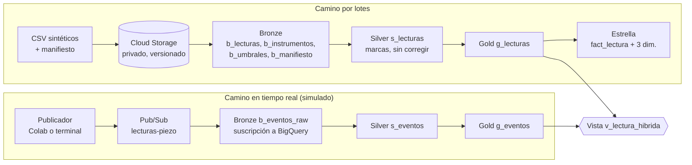

# Monitoreo piezométrico de un depósito de relaves en Google Cloud: demo end-to-end

Demo reproducible de un pipeline de datos para lecturas piezométricas: ingesta por lotes y en tiempo real (simulado), capas bronze/silver/gold, esquema en estrella, vista híbrida y verificaciones automáticas. Proyecto final del curso de Deep Learning (Maestría en Ciencia de Datos e IA, UTEC), entregas 1 a 3.

> **Datos sintéticos.** Este repositorio no contiene datos de ninguna operación. El script `synthetic/generar_datos.py` inventa instrumentos, coordenadas, niveles y lecturas con la misma estructura que el lote usado en el informe. Las cifras del informe de la entrega 2 (35,632 lecturas, 80 instrumentos, 353 tramos) se midieron con un lote **seudonimizado** de otra procedencia; este demo produce cifras distintas con las mismas reglas.
>
> **Alcance.** Es un ejercicio de ingeniería de datos. No evalúa la estabilidad ni la seguridad de ninguna presa y no sustituye el sistema de monitoreo de seguridad, el criterio del ingeniero de registro ni la revisión independiente. Los niveles (NPC, NAC, NAM, NCA) del generador son arbitrarios y están marcados como `provisional`.

## Contenido

1. [Arquitectura](#arquitectura)
2. [Estructura del repositorio](#estructura-del-repositorio)
3. [Requisitos](#requisitos)
4. [Inicio rápido](#inicio-rápido)
5. [Qué hace cada etapa](#qué-hace-cada-etapa)
6. [Reglas de calidad](#reglas-de-calidad)
7. [Modelo en estrella](#modelo-en-estrella)
8. [Verificaciones y pruebas](#verificaciones-y-pruebas)
9. [Costos y limpieza](#costos-y-limpieza)
10. [Limitaciones](#limitaciones)
11. [Estado de validación](#estado-de-validación)

## Arquitectura



Decisiones principales: SQL en BigQuery como motor (el volumen no justifica Spark ni Flink); marcar sin corregir, para que cada depuración sea auditable; suscripción de Pub/Sub directa a BigQuery, sin suscriptor propio; vista híbrida con marca de agua para no contar dos veces una misma fecha; procedimientos que registran cada ejecución en la tabla `ejecuciones`.

## Estructura del repositorio

```
.
├── deploy.sh                 # lote | flujo | todo
├── destroy.sh                # elimina todo y lista lo que queda
├── config.env.example        # copiar a config.env y poner PROYECTO
├── scripts/
│   ├── comun.sh              # funciones compartidas (tokens, verificaciones)
│   └── 00_proyecto.sh        # opcional: proyecto, facturación, APIs y presupuesto
├── synthetic/generar_datos.py   # datos sintéticos + manifiesto con conteos esperados
├── sql/                      # 00 auditoría · 10 silver/gold · 11 exclusiones · 20 estrella
│                             # 30 consultas · 50 eventos · 60 vista híbrida · 70 latencia
├── publicador/               # eventos.py (generación) · publicar_eventos.py (terminal)
├── notebooks/B4_publicador_eventos.ipynb   # el mismo publicador para Colab
├── verificaciones/           # 5 archivos SQL: cada fila dice OK o FALLA
└── tests/test_local_duckdb.py   # prueba local de la lógica SQL, sin nube
```

Los archivos SQL usan los tokens `__PROYECTO__` y `__DATASET__`; `deploy.sh` los reemplaza al ejecutar.

## Requisitos

- Un proyecto de Google Cloud con facturación activa (puede crearse con `scripts/00_proyecto.sh`).
- Google Cloud Shell (trae `gcloud`, `bq`, `git` y `python3`) o cualquier terminal con esas herramientas y sesión iniciada.
- Permisos de propietario o equivalente sobre el proyecto (crea bucket, dataset, tema, suscripción y asigna roles).

## Inicio rápido

En Cloud Shell, un comando a la vez:

```bash
git clone https://github.com/raultyv/Big_data_piezometria-gcp-demo && cd Big_data_piezometria-gcp-demo
cp config.env.example config.env && nano config.env     # poner PROYECTO=<su-proyecto>
./deploy.sh lote      # bucket, dataset, bronze, silver, gold, estrella y verificaciones
./deploy.sh flujo     # Pub/Sub, publicador simulado, eventos, vista híbrida y verificaciones
./destroy.sh          # al terminar: borra los recursos y muestra lo que queda
```

`./deploy.sh todo` ejecuta lote y flujo seguidos. Cada etapa termina con tablas de comprobaciones (`OK` o `FALLA`); si alguna falla, el script se detiene con error.

Para crear también el proyecto y un presupuesto con alertas (opcional):

```bash
scripts/00_proyecto.sh <ID_PROYECTO> <ID_CUENTA_FACTURACION> 50PEN
```

## Qué hace cada etapa

| Etapa | Qué crea | Qué comprueba |
|---|---|---|
| Datos sintéticos | 3 CSV, manifiesto y resumen con conteos esperados (calculados aparte del SQL) | Salida determinista con la misma semilla |
| Bronze | Bucket privado y versionado; `b_lecturas`, `b_instrumentos`, `b_umbrales`, `b_manifiesto` con tipos explícitos | Filas, instrumentos, tramos y huella frente al manifiesto; sin fechas futuras |
| Silver y gold | `sp_actualizar()` → `s_lecturas`, `g_lecturas`; vista `v_exclusiones`; registro en `ejecuciones` | Duplicados y conflictos marcados; silver = gold + exclusiones; sin repetidos en gold |
| Estrella | `sp_modelar()` → `dim_instrumento`, `dim_fecha`, `dim_umbral`, `fact_lectura` (particionada por mes, agrupada por instrumento) | Conteos, sin huérfanos, cuatro niveles vigentes en cada hecho |
| Pub/Sub | Tema, tabla `b_eventos_raw`, suscripción a BigQuery con metadatos y roles para la identidad de Pub/Sub | Enviados = recibidos |
| Eventos | `sp_procesar_eventos()` → `s_eventos`, `g_eventos`; `v_lectura_hibrida` | Cada falla inyectada marcada; vista = gold del lote + gold del flujo |
| Latencia | Consulta informativa sobre los eventos únicos | Mediana, p95 y máximo hasta publicar |

## Reglas de calidad

Silver agrega una marca por regla y **no modifica el dato**. Solo gold excluye.

| Marca | Regla | ¿Sale de gold? |
|---|---|---|
| `es_duplicado_exacto` | Mismo instrumento y fecha, mismo NPA, segunda copia o posterior | Sí |
| `es_fecha_conflicto` | Mismo instrumento y fecha con NPA distinto (se marcan ambas filas) | Sí |
| `es_npa_nulo` | NPA vacío | Sí |
| `fuera_escalera` | No se cumple NPC > NAC > NAM en la fila | No: se conserva y se informa |
| `sin_catalogo` | Instrumento ausente del catálogo | Informativa |
| `sin_nivel_vigente` | Sin tramo de NPC vigente en la fecha | Informativa (el cruce de gold exige los cuatro niveles) |

Los niveles se guardan con vigencia y estado en `b_umbrales`; cambiar un criterio no exige tocar el código. Este demo solo **compara** la lectura con los niveles y calcula márgenes: no los define ni interpreta su significado para la seguridad.

Para el flujo: entregas duplicadas (mismo `evento_id`), instrumento inexistente, NPA nulo y NPA no numérico se marcan en `s_eventos`; `g_eventos` conserva un evento válido por instrumento y fecha.

## Modelo en estrella

`fact_lectura` (una fila por lectura válida, con márgenes a cada nivel, indicadores `sobre_*` y claves a las dimensiones) · `dim_instrumento` · `dim_fecha` · `dim_umbral` (tramos con vigencia, estado y fuente). Cada hecho conserva `fila_origen` y `archivo_sha256`, de modo que se puede rastrear hasta el archivo del lote.

## Verificaciones y pruebas

- **En la nube:** los 5 archivos de `verificaciones/` se ejecutan dentro de `deploy.sh`. Comparan BigQuery con el manifiesto que generó el script de datos.
- **Local, sin nube:** `python3 tests/test_local_duckdb.py` traduce el SQL de BigQuery a DuckDB (con `sqlglot`) y ejecuta toda la lógica, incluido el flujo simulado. Requiere `pip install duckdb sqlglot`. No prueba particionado, clustering, procedimientos, Pub/Sub ni IAM.

## Costos y limpieza

- La estimación de costos de la arquitectura propuesta está en el documento de la entrega 1 (Calculadora de precios de Google Cloud, con fecha y supuestos). Este demo, con unos 5 MB de datos, queda dentro de los niveles gratuitos de BigQuery y Cloud Storage según la documentación de Google; confirmar los valores vigentes en las páginas oficiales de precios antes de usarlo con otros volúmenes.
- Un presupuesto de Google Cloud **avisa, no corta el gasto**. Revise el reporte de facturación después de cada etapa.
- `./destroy.sh` elimina suscripción, tema, dataset y bucket (con todas sus versiones) y lista lo que queda. Con `--proyecto` borra además el proyecto.

## Limitaciones

- El tiempo real es una **simulación declarada**: no hay sensores; las lecturas base se reenvían con fechas +7 días y se inyectan fallas sintéticas.
- La latencia se mide en una sola corrida y con pocos mensajes; mezcla agrupamiento del cliente, red y posible desfase de reloj. No es una prueba de carga.
- Los roles de la suscripción de Pub/Sub se asignan a nivel de proyecto (aceptable en un proyecto de pruebas; en producción se limitarían al dataset).
- Sin orquestación ni alertas: los procedimientos se ejecutan desde el script. Trabajo futuro: consultas programadas, cola de mensajes fallidos y fuentes adicionales (caudales, topografía, informes PDF).
- Una sola fuente de lotes; no se probaron Spark ni Flink.

## Estado de validación

| Qué | Estado |
|---|---|
| Lógica SQL sobre datos sintéticos (DuckDB, 35 comprobaciones) | Probada localmente |
| `deploy.sh` y `destroy.sh` con una corrida real en Google Cloud | **Pendiente de la corrida de validación (se registra aquí con fecha al completarla)** |
| `scripts/00_proyecto.sh` (proyecto, facturación, presupuesto) | Pendiente de la corrida de validación |

Mientras una fila diga «pendiente», esa pieza está escrita pero no probada en Google Cloud.
